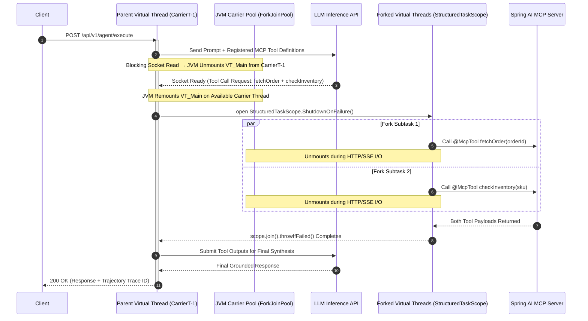
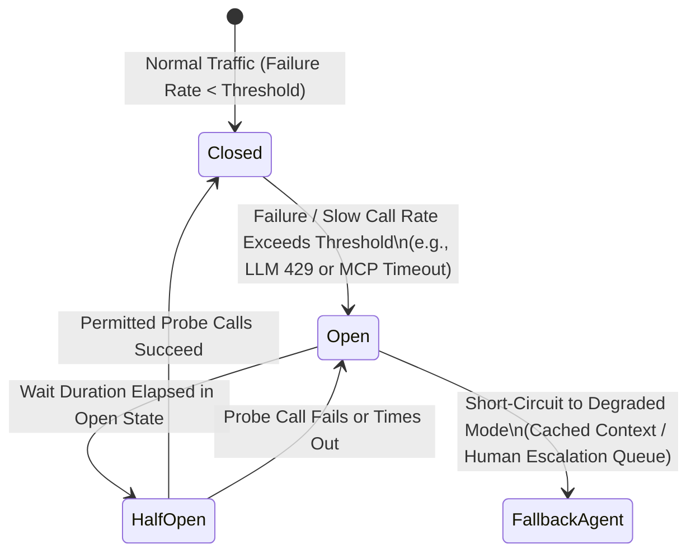

# Architecting High-Throughput Agentic AI Gateways with Java 21+ Virtual Threads, Spring AI, and MCP

## Imperative Thread-Per-Request Models Exhaust OS Resources Under Agentic AI Workloads

Traditional Java microservices rely on operating-system-backed platform threads (`java.lang.Thread` with 1:1 kernel scheduling), where each thread reserves roughly 1 MB to 2 MB of stack memory and requires expensive kernel context switches. While a standard REST CRUD endpoint holds a thread for 5–20 milliseconds during a database lookup, modern agentic AI workflows invert this latency profile:

* **Long-lived I/O waits dominate execution time:** A single agentic request orchestrating multi-turn LLM reasoning, vector retrieval, and external tool calls via the Model Context Protocol (MCP) routinely blocks on network I/O for 2 to 30 seconds.
* **Platform thread pools saturate long before CPU or network bandwidth:** At 200 to 500 concurrent requests, a conventional Tomcat thread pool exhausts available threads, queuing incoming requests even while CPU utilization sits below 10%.
* **Reactive stacks introduce severe observability and maintenance friction:** Migrating to non-blocking reactive frameworks (`WebFlux` / `Project Reactor`) resolves thread starvation but fractures stack traces, complicates debugging, and forces teams to rewrite imperative business logic into complex reactive chains.

Furthermore, agentic systems fail in production primarily due to six architectural gaps rather than model quality: missing termination contracts (infinite loops), overly broad tool permissions, ephemeral state where durable state is required, output-only evaluation instead of trajectory evaluation, shallow observability, and missing human escalation paths.

## M:N Virtual Thread Scheduling Decouples Concurrency Scale from OS Thread Limits

Introduced as a finalized feature in Java 21 via JEP 444, virtual threads employ M:N scheduling to map millions of lightweight user-mode threads (starting at roughly 1 KB of heap-allocated stack memory) onto a small pool of OS carrier threads managed by the JVM's work-stealing `ForkJoinPool`.

When a microservice built with Spring AI invokes a blocking LLM streaming endpoint or fans out to multiple Spring AI MCP Servers, the JVM automatically unmounts the blocked virtual thread from its carrier thread, copying its stack frames to the heap. The carrier thread immediately executes another pending virtual thread until the network socket signals readiness.

## Structured Concurrency Eliminates Thread Leaks Across Parallel Tool and RAG Fan-Out

In an enterprise agentic workflow, a single user turn often requires parallel context assembly—fetching user profile metadata, querying a vector database, and invoking multiple Spring AI Tool Calling, endpoints simultaneously. Using raw `CompletableFuture.allOf()` makes cancellation and error propagation brittle: if one downstream tool fails, sibling tasks continue executing in the background, leaking tokens and database connections.

JEP 453: Structured Concurrency(further refined in JEP 505) treats groups of concurrent subtasks forked within a lexical scope as a single unit of work via `StructuredTaskScope`:

* **Short-circuit error handling (`ShutdownOnFailure`):** If an authentication check or critical MCP tool fails, the scope automatically cancels all remaining in-flight subtasks and propagates the exception cleanly.
* **Hierarchical observability:** Thread dumps generated via `jcmd <pid> Thread.dump_to_file -format=json` preserve the parent-child tree between the orchestrating virtual thread and its forked tool-execution subtasks (JEP 453 Observability Specification).



## Production Case Studies Reveal Critical Failure Modes in Virtual Threads and Agentic Systems

### Case Study 1: How Netflix Diagnosed Virtual Thread Pinning Under Lock Contention

When Netflix migrated its Java microservices fleet to Java 21 and enabled virtual threads on Spring Boot 3, engineers encountered intermittent timeouts where instances stopped serving traffic despite low CPU usage. Investigation revealed a subtle interaction between `synchronized` blocks, `ReentrantLock`, and virtual thread scheduling:

1. **Carrier Thread Pinning in Java 21:** In JDK 21, a virtual thread executing inside a `synchronized` method or block cannot unmount from its underlying OS carrier thread if it encounters a blocking operation (JEP 444 Specification).
2. **Starvation Cascade:** When the number of pinned virtual threads equaled the number of CPU cores (`ForkJoinPool` carrier count), all carrier threads became pinned, preventing unmounted virtual threads—including the thread holding the lock—from ever being scheduled to release the monitor.
3. **Architectural Mitigation:** Engineers replace `synchronized` guards around I/O paths with `java.util.concurrent.locks.ReentrantLock` in JDK 21, or upgrade to JDK 24+ where JEP 491: Synchronize Virtual Threads without Pinning revamps the JVM object monitor implementation so virtual threads can acquire, hold, and release `synchronized` monitors independently of their carrier threads.

### Case Study 2: How Stripe and Uber Enforce Boundaries for Production AI Agents

In large-scale distributed systems at Uber and Stripe, production resilience relies on strict boundary isolation rather than assuming downstream calls will succeed:

* **Downstream Backpressure and Bulkheads:** Because virtual threads remove the natural concurrency ceiling of a 200-thread pool, an unthrottled microservice can instantaneously open 50,000 concurrent calls against a downstream database or LLM API. Production services guard downstream dependencies using `Semaphore` permits or Resilience4j CircuitBreaker and Bulkhead decorators.
* **Idempotent Tool Execution & Transactional Outbox:** As documented in the an agent that retries a tool call on a timeout can accidentally double-charge a customer if the tool lacks an idempotency key. Mutating agent actions must persist state transitions and domain events atomically using the Transactional Outbox Pattern.



## Reference Implementation Combines Spring AI MCP, Structured Concurrency, and Bulkhead Guardrails

The following reference implementation demonstrates how to wire virtual threads in Spring Boot 3.2+, enforce a `Semaphore` bulkhead around parallel Spring AI and MCP calls, and replace memory-heavy `ThreadLocal` variables with `ScopedValue`.

```java
package com.architecture.agentic.gateway;

import io.github.resilience4j.circuitbreaker.annotation.CircuitBreaker;
import org.springframework.ai.chat.client.ChatClient;
import org.springframework.ai.mcp.SyncMcpToolCallbackProvider;
import org.springframework.stereotype.Service;

import java.time.Duration;
import java.time.Instant;
import java.util.concurrent.Semaphore;
import java.util.concurrent.StructuredTaskScope;

@Service
public class AgenticOrchestrationService {

    // Guard downstream vector DB and MCP servers from virtual-thread concurrency spikes
    private final Semaphore downstreamBulkhead = new Semaphore(120);
    private final ChatClient chatClient;
    private final VectorRetrievalClient vectorClient;
    private final OrderLedgerClient orderLedgerClient;

    // Prefer ScopedValue over ThreadLocal to prevent heap bloat across millions of virtual threads
    public static final ScopedValue<String> TRACE_ID = ScopedValue.newInstance();

    public AgenticOrchestrationService(
            ChatClient.Builder chatClientBuilder,
            SyncMcpToolCallbackProvider mcpToolProvider,
            VectorRetrievalClient vectorClient,
            OrderLedgerClient orderLedgerClient) {
        this.chatClient = chatClientBuilder
                .defaultTools(mcpToolProvider.getToolCallbacks())
                .build();
        this.vectorClient = vectorClient;
        this.orderLedgerClient = orderLedgerClient;
    }

    @CircuitBreaker(name = "agentOrchestrator", fallbackMethod = "escalateToHumanQueue")
    public AgentResponse executeBoundedAgentTurn(String traceId, String customerId, String userPrompt) {
        return ScopedValue.where(TRACE_ID, traceId).call(() -> {
            // Phase 1: Parallel Context Assembly via StructuredTaskScope (JEP 453 / JEP 505)
            try (var scope = new StructuredTaskScope.ShutdownOnFailure()) {
                var ragSubtask = scope.fork(() -> acquireWithBulkhead(
                        () -> vectorClient.hybridSearch(userPrompt, 5)));
                var ledgerSubtask = scope.fork(() -> acquireWithBulkhead(
                        () -> orderLedgerClient.fetchRecentState(customerId)));

                // Enforce strict deadline on context fan-out
                scope.joinUntil(Instant.now().plus(Duration.ofSeconds(4)));
                scope.throwIfFailed();

                String groundedContext = ragSubtask.get() + "\n" + ledgerSubtask.get();

                // Phase 2: Bounded Spring AI + MCP Tool Execution on Virtual Thread
                String answer = chatClient.prompt()
                        .system(s -> s.text("""
                                You are a bounded order-resolution agent.
                                Strict Contract: Use only verified context and registered MCP tools.
                                Context: {context}
                                """).param("context", groundedContext))
                        .user(userPrompt)
                        .call()
                        .content();

                return new AgentResponse(traceId, "COMPLETED", answer);
            }
        });
    }

    private <T> T acquireWithBulkhead(java.util.concurrent.Callable<T> task) throws Exception {
        downstreamBulkhead.acquire();
        try {
            return task.call();
        } finally {
            downstreamBulkhead.release();
        }
    }

    public AgentResponse escalateToHumanQueue(String traceId, String customerId, String userPrompt, Throwable ex) {
        return new AgentResponse(traceId, "ESCALATED_TO_HUMAN",
                "Request queued for human review due to downstream dependency degradation.");
    }

    public record AgentResponse(String traceId, String status, String payload) {}
}
```

## Architectural Trade-Off Matrix Favors Virtual Threads for I/O-Heavy AI Microservices

When selecting a concurrency and orchestration runtime for Java-based AI and backend microservices, architects must balance throughput, memory footprint, debugging ergonomics, and backpressure control:

| Architectural Dimension        | Platform Thread Pool (Spring MVC Classic) | Reactive Non-Blocking (Spring WebFlux)    | Virtual Threads + Structured Concurrency (Java 21+)                                      |
| :----------------------------- | :---------------------------------------- | :---------------------------------------- | :--------------------------------------------------------------------------------------- |
| **Scheduling Model**           | 1:1 OS Kernel Threads (JEP 444)           | Event Loop + Async Callbacks              | M:N JVM Carrier Threads (`ForkJoinPool`) (JEP 444)                                       |
| **Memory per Concurrent Task** | ~1 MB – 2 MB reserved stack               | Minimal heap allocation per operator      | ~1 KB initial heap-backed stack                                                          |
| **Max Concurrent I/O Waits**   | 200 – 2,000 threads before OS thrashing   | 50,000+ concurrent connections            | 100,000 – 1,000,000+ virtual threads                                                     |
| **Stack Trace & Debugging**    | Clean, sequential stack traces            | Fragmented async assembly traces          | Clean, sequential stack traces + JSON hierarchy (JEP 453)                                |
| **Primary Production Risk**    | Thread pool starvation on slow LLM calls  | Steep cognitive load and reactive lock-in | Carrier pinning on `synchronized` (fixed in JEP 491) & downstream DDoS without bulkheads |
| **Best Fit Workload**          | CPU-bound or low-concurrency legacy apps  | High-frequency streaming transformations  | Agentic AI gateways, MCP servers, & I/O-bound microservices                              |
