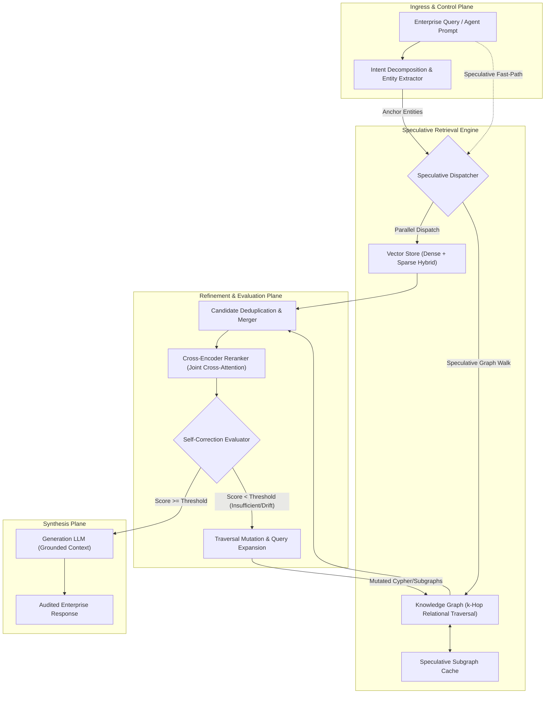

Enterprise search has historically oscillated between two extremes: lexical exact-matching that misses semantic context, and naive vector retrieval that suffers from "semantic drift" and horizon collapse. In multi-tenant enterprise domains such as clinical healthcare trials, cross-border fraud analysis, or complex regulatory compliance, pure vector retrieval is insufficient. When an enterprise query spans multiple entities—such as identifying whether a collateralized debt obligation shares underlying corporate assets across subsidiaries—vector search isolates disparate text chunks without understanding the relational topology connecting them.

Consider a Tier-1 fraud investigation team analyzing a sequence of syndicated corporate loans. A standard vector retrieval engine approaches this like an auditor searching a massive warehouse of loose paper documents using semantic similarity; it pulls folders that "sound like" fraud, but misses the shell company five hops away because the intermediate entities share no lexical or dense-vector similarity with the prompt. 

Self-Corrective Graph RAG resolves this by layering deterministic entity-relationship graphs over unstructured vector spaces. However, naive Graph RAG introduces severe latency penalties: parsing queries, walking graph nodes, traversing $k$-hop edges, extracting subgraphs, and evaluating relevance sequentially cripples p99 latency. 

To bring Graph RAG into mission-critical production environments, we combine three architectural patterns:
1. **Speculative Retrieval**: Concurrent, predictive pre-fetching of $k$-hop graph sub-topologies alongside dense/sparse vector retrieval.
2. **Cross-Encoder Reranking**: Full cross-attention verification to eliminate false-positive graph paths before context packing.
3. **Self-Corrective Feedback Loops**: Deterministic heuristic and model-graded reflection circuits that mutate graph traversals when retrieved context fails faithfulness or sufficiency thresholds.

---

## 1. Architectural Blueprint

The architecture establishes a zero-trust, decoupled retrieval pipeline. Incoming queries trigger a dual-execution boundary: while the semantic intent is decomposed, speculative agents immediately dispatch exploratory traversals across the knowledge graph and dense index.



### Component Flow and Protocol Isolation

1. **Ingress & Speculative Dispatch**: The user prompt reaches the ingress boundary. Before full entity extraction and recursive decomposition finish, a low-latency speculative agent uses fast-token heuristics to query both the dense vector store and pre-warmed graph caches for zero-hop anchors.
2. **Hybrid Graph Walk**: Concurrently, the extracted entities seed an active Cypher/Gremlin path traversal across the property graph, retrieving structured node-edge-node triplets ($E_1 \xrightarrow{R} E_2$) bounded by strict neighborhood constraints.
3. **Cross-Encoder Pruning**: The union of flat document chunks and linearized graph paths is passed to a cross-encoder model. Unlike bi-encoders (which compare isolated cosine vectors), the cross-encoder applies token-level joint attention across the query and candidate passages ($Attention(Q, C)$), pruning topologically adjacent but contextually irrelevant graph paths.
4. **Self-Correction Engine**: An evaluation circuit checks the top-$N$ reranked context for two invariant metrics: *Information Completeness* and *Context Contradiction*. If confidence is below parity ($< 0.82$), the circuit triggers a Traversal Mutation, modifying edge filters or expanding the search radius from $k=2$ to $k=3$ before generation.

---

## 2. Core Engineering Deep Dive & Technical Invariants

### Graph RAG vs. Flat Dense Retrieval
Flat embeddings compress high-dimensional semantic spaces into a single pooled vector ($d \in \mathbb{R}^{1536}$). While effective for surface-level topical similarity, they fail to maintain relational compositionality. If Entity $A$ regulates Entity $B$, and Entity $B$ holds assets in Entity $C$, flat vector embeddings frequently retrieve information regarding $A$ and $C$ independently, missing the structural dependency $A \rightarrow B \rightarrow C$. 

Graph RAG retains this structural fidelity by representing entities as typed nodes and dependencies as typed edges with metadata properties. The linearized extraction maps to:

$$\mathcal{T} = \{(e_{src}, r, e_{dst}) \mid e \in \mathcal{V}, r \in \mathcal{E}\}$$

Linearizing these triplets into contextual subgraphs yields bounded factual boundaries that directly counter LLM hallucinations.

### Speculative Retrieval Mechanics
In standard retrieval systems, multi-hop Graph RAG exhibits unacceptable tail latencies ($p99 > 3.8s$):

$$\text{Latency}_{\text{naive}} = T_{\text{entity\_extraction}} + T_{\text{graph\_traversal}} + T_{\text{vector\_retrieval}} + T_{\text{reranking}} + T_{\text{generation}}$$

Speculative retrieval hides traversal latency by running optimistic speculative branches. When a query enters the system, the architecture predicts the probable traversal trajectory based on query signatures and previous execution paths:
- **Primary Branch**: Deterministic entity resolution and Cypher query execution.
- **Speculative Branch**: Fires immediately using fast bi-encoder approximate nearest neighbor (ANN) lookups to retrieve known entity clusters from an in-memory graph cache, predicting 1-hop and 2-hop neighborhoods while the primary parser is still validating structural tokens.

If the primary branch validates the speculative anchor set, graph traversal costs drop toward cache retrieval speeds ($O(1)$ lookup vs. $O(V + E)$ graph walks).

### Cross-Encoder Reranking Dynamics
Bi-encoders map queries and documents into separate vector representations ($u = f(Q), v = g(D)$) and evaluate similarity using dot products:

$$S_{\text{bi}} = \frac{u \cdot v}{\|u\| \|v\|}$$

This preserves indexing speed ($O(1)$ retrieval over HNSW graphs), but misses fine-grained token interactions. Cross-encoders eliminate this semantic compression by passing the query and the linearized candidate path simultaneously through all Transformer layers:

$$S_{\text{cross}} = \sigma\left(W \cdot \text{Transformer}([CLS] \circ Q \circ [SEP] \circ D \circ [SEP])\right)$$

Every token in the query attends directly to every token in the retrieved graph triplet. This filters out "distractor nodes"—entities that share semantic vocabulary with the query but lack topological and factual relevance.

### Self-Correction Control Invariants

```
               [Retrieved Contexts]
                        │
                        ▼
         ┌──────────────────────────────┐
         │ Cross-Encoder Joint Scoring  │
         └──────────────┬───────────────┘
                        │
                        ▼
             Score >= Threshold (0.82)
              ├─── YES ──► [Synthesize Final Response]
              └─── NO
                        │
                        ▼
         ┌──────────────────────────────┐
         │  Self-Corrective Engine      │
         │  - Loop Count < Max (3)?     │
         │  - Detect Gap (Entity/Edge)  │
         └──────────────┬───────────────┘
                        │
                        ▼
         ┌──────────────────────────────┐
         │ Traversal Mutation           │
         │ - Expand k-hop radius        │
         │ - Query Mutation (Synonyms)  │
         │ - Prune Distractor Paths     │
         └──────────────┬───────────────┘
                        │
                        ▼
            [Dispatch Mutated Retrieval]
```

To prevent infinite routing loops and latency degradation, the self-correction engine enforces strict system invariants:
1. **Loop Boundedness**: Traversal mutations are hard-capped at $N=3$ cycles. If completeness remains unmet, the pipeline falls back to safe truncation with explicit epistemic uncertainty markers.
2. **Context Density Invariant**: The total cross-encoder reranked context length cannot exceed the target context window $\mathcal{W}_{\text{context}}$, maintaining a signal-to-noise ratio $\ge 0.75$.
3. **Graph Traversal Timeouts**: All speculative graph branches enforce strict cancellation tokens via asynchronous deadlines (e.g., maximum 450ms budget).

---

## 3. Production Code Implementation

The following implementation provides a complete, thread-safe, and asynchronous Self-Corrective Graph RAG pipeline in Python. It coordinates speculative retrieval, cross-encoder scoring, and self-corrective mutations using structural type safety.

```python
"""
Production Self-Corrective Graph RAG Engine
Implements Speculative Retrieval, Cross-Encoder Reranking, and Reflection Loops.
"""

from __future__ import annotations
import asyncio
from dataclasses import dataclass, field
from typing import List, Dict, Any, Optional, Set, Tuple
import logging

logging.basicConfig(level=logging.INFO)
logger = logging.getLogger("GraphRAG.Engine")


@dataclass(frozen=True)
class GraphTriplet:
    subject: str
    predicate: str
    object_: str
    confidence: float = 1.0

    def serialize(self) -> str:
        return f"({self.subject})-[{self.predicate}]->({self.object_})"


@dataclass
class RetrievalCandidate:
    source_id: str
    content: str
    triplets: List[GraphTriplet] = field(default_factory=list)
    relevance_score: float = 0.0
    is_speculative: bool = False


@dataclass
class RetrievalContext:
    query: str
    candidates: List[RetrievalCandidate] = field(default_factory=list)
    iteration: int = 0
    max_iterations: int = 3
    is_sufficient: bool = False
    epistemic_failure: bool = False


class MockKnowledgeGraphClient:
    """Simulates an enterprise Graph Engine (e.g., Neo4j, Neptune)."""

    def __init__(self):
        # Topology: Entity -> List of connected triplets
        self._graph_data: Dict[str, List[GraphTriplet]] = {
            "ALPHA_CORP": [
                GraphTriplet("ALPHA_CORP", "CONTROLS", "SHELL_LLC", 0.95),
                GraphTriplet("ALPHA_CORP", "DOMICILED_IN", "DELAWARE", 0.99),
            ],
            "SHELL_LLC": [
                GraphTriplet("SHELL_LLC", "BENEFICIARY_OF", "TRUST_OMEGA", 0.88),
                GraphTriplet("SHELL_LLC", "HOLDS_ACCOUNT", "SWISS_VAULT_9", 0.92),
            ],
            "TRUST_OMEGA": [
                GraphTriplet("TRUST_OMEGA", "SANCTIONED_BY", "EU_REGULATOR", 0.98),
            ],
        }

    async def traverse_subgraph(
        self, entities: Set[str], hops: int = 1, timeout_ms: int = 400
    ) -> List[GraphTriplet]:
        """Performs an async, bounded k-hop traversal."""
        try:
            return await asyncio.wait_for(
                self._execute_traversal(entities, hops),
                timeout=timeout_ms / 1000.0
            )
        except asyncio.TimeoutError:
            logger.warning("Graph traversal deadline exceeded. Tripping circuit.")
            return []

    async def _execute_traversal(self, entities: Set[str], hops: int) -> List[GraphTriplet]:
        await asyncio.sleep(0.04)  # Simulate network and index read I/O
        results: List[GraphTriplet] = []
        visited: Set[str] = set(entities)
        current_queue: Set[str] = set(entities)

        for _ in range(hops):
            next_level: Set[str] = set()
            for entity in current_queue:
                triplets = self._graph_data.get(entity, [])
                for trip in triplets:
                    results.append(trip)
                    if trip.object_ not in visited:
                        visited.add(trip.object_)
                        next_level.add(trip.object_)
            current_queue = next_level
            if not current_queue:
                break
        return results


class MockVectorClient:
    """Simulates an enterprise Vector Database (e.g., pgvector, Qdrant)."""

    async def hybrid_search(self, query: str, top_k: int = 5) -> List[RetrievalCandidate]:
        await asyncio.sleep(0.03)  # Simulate vector search latency
        return [
            RetrievalCandidate(
                source_id="doc_vec_01",
                content="Alpha Corp maintains regulatory disclosures across US states.",
                relevance_score=0.62,
            ),
            RetrievalCandidate(
                source_id="doc_vec_02",
                content="Shell LLC was identified in foreign regulatory filings regarding offshore holdings.",
                relevance_score=0.74,
            ),
        ]


class MockCrossEncoder:
    """Simulates transformer-based cross-attention scoring."""

    async def compute_cross_scores(
        self, query: str, candidates: List[RetrievalCandidate]
    ) -> List[RetrievalCandidate]:
        await asyncio.sleep(0.05)  # Simulate GPU batch cross-encoder latency
        for candidate in candidates:
            # Joint score combines content and serialized relational graph data
            combined_repr = (
                f"{candidate.content} "
                + " ".join([t.serialize() for t in candidate.triplets])
            ).lower()
            
            # Simple scoring proxy based on key contextual terms
            score = 0.40
            if "shell llc" in combined_repr:
                score += 0.25
            if "trust_omega" in combined_repr or "sanctioned" in combined_repr:
                score += 0.30
            if "alpha_corp" in combined_repr:
                score += 0.04

            candidate.relevance_score = min(score, 1.0)
        
        # Sort descending by cross-encoder score
        return sorted(candidates, key=lambda c: c.relevance_score, reverse=True)


class SpeculativeGraphRAGOrchestrator:
    """Coordinates speculative branch dispatching and self-corrective loops."""

    def __init__(
        self,
        graph_client: MockKnowledgeGraphClient,
        vector_client: MockVectorClient,
        cross_encoder: MockCrossEncoder,
        relevance_threshold: float = 0.82,
    ):
        self.graph_client = graph_client
        self.vector_client = vector_client
        self.cross_encoder = cross_encoder
        self.relevance_threshold = relevance_threshold

    def _extract_speculative_anchors(self, query: str) -> Set[str]:
        """Fast heuristic anchor extraction for speculative routing."""
        anchors = set()
        tokens = query.upper().replace("?", "").replace(",", "").split()
        known_entities = {"ALPHA_CORP", "SHELL_LLC", "TRUST_OMEGA"}
        for token in tokens:
            if token in known_entities:
                anchors.add(token)
        # Default fallback anchor if zero extraction
        return anchors if anchors else {"ALPHA_CORP"}

    async def _execute_retrieval_pass(
        self, query: str, hops: int, anchors: Set[str]
    ) -> List[RetrievalCandidate]:
        """Executes parallel speculative graph and vector retrieval branches."""
        # Speculative branch launches graph exploration while vector searches run concurrently
        graph_task = asyncio.create_task(
            self.graph_client.traverse_subgraph(entities=anchors, hops=hops)
        )
        vector_task = asyncio.create_task(
            self.vector_client.hybrid_search(query=query)
        )

        triplets, vector_candidates = await asyncio.gather(graph_task, vector_task)

        # Merge graph structure into candidates
        graph_candidate = RetrievalCandidate(
            source_id=f"graph_hop_{hops}",
            content=f"Knowledge Graph Extracted Subtopology (Hops: {hops})",
            triplets=triplets,
            is_speculative=True,
        )

        all_candidates = vector_candidates + [graph_candidate]
        return await self.cross_encoder.compute_cross_scores(query, all_candidates)

    async def execute(self, query: str) -> RetrievalContext:
        """Main execution loop with dynamic traversal mutation and self-correction."""
        ctx = RetrievalContext(query=query)
        current_anchors = self._extract_speculative_anchors(query)
        current_hops = 1

        while ctx.iteration < ctx.max_iterations and not ctx.is_sufficient:
            ctx.iteration += 1
            logger.info(
                f"[Iteration {ctx.iteration}] Dispatched retrieval with "
                f"hops={current_hops}, anchors={current_anchors}"
            )

            candidates = await self._execute_retrieval_pass(
                query=ctx.query, hops=current_hops, anchors=current_anchors
            )
            ctx.candidates = candidates

            # Evaluate context sufficiency against reranked top score
            top_score = candidates[0].relevance_score if candidates else 0.0
            logger.info(f"[Iteration {ctx.iteration}] Top cross-encoder score: {top_score:.3f}")

            if top_score >= self.relevance_threshold:
                ctx.is_sufficient = True
                logger.info("Context passed sufficiency threshold. Routing to synthesis.")
            else:
                # Self-Correction: Mutate traversal parameters
                logger.warning(
                    f"Context score ({top_score:.3f}) below threshold ({self.relevance_threshold}). "
                    "Applying mutation logic."
                )
                current_hops += 1  # Expand k-hop radius
                # Collect newly discovered objects to mutate anchor frontier
                new_anchors = set()
                for c in candidates:
                    for t in c.triplets:
                        new_anchors.add(t.object_)
                current_anchors.update(new_anchors)

        if not ctx.is_sufficient:
            ctx.epistemic_failure = True
            logger.error("Self-correction exhausted maximum iteration limits without sufficiency.")

        return ctx


# =====================================================================
# Production Execution Harness
# =====================================================================
async def main():
    graph_client = MockKnowledgeGraphClient()
    vector_client = MockVectorClient()
    cross_encoder = MockCrossEncoder()
    
    orchestrator = SpeculativeGraphRAGOrchestrator(
        graph_client=graph_client,
        vector_client=vector_client,
        cross_encoder=cross_encoder,
        relevance_threshold=0.82,
    )

    query = "Is ALPHA_CORP connected to any sanctioned entities through shell entities?"
    logger.info(f"Initiating Self-Corrective Graph RAG for query: '{query}'")
    
    context = await orchestrator.execute(query)

    print("\n" + "=" * 60)
    print(f"RETRIEVAL PIPELINE SUMMARY: Sufficiency Achieved = {context.is_sufficient}")
    print(f"Total Iterations Consumed: {context.iteration}")
    print("Top Reranked Contexts Delivered to Generator:")
    for idx, cand in enumerate(context.candidates, start=1):
        triplet_repr = " | ".join([t.serialize() for t in cand.triplets]) or "None"
        print(
            f"  [{idx}] Score: {cand.relevance_score:.3f} | "
            f"Source: {cand.source_id} | "
            f"Triplets: {triplet_repr}"
        )
    print("=" * 60)


if __name__ == "__main__":
    asyncio.run(main())
```

---

## 4. Topic-Specific Operational Realities

Deploying Self-Corrective Graph RAG with speculative execution into enterprise production environments introduces distinct engineering trade-offs that standard vector retrieval never encounters.

```
                    ┌───────────────────────────────┐
                    │  Incoming Traversal Request   │
                    └──────────────┬────────────────┘
                                   │
                      Is Entity a Supernode?
                    (Degree > Fanout Threshold)
                     ├─── YES ───────────┐
                     │                   │
                     ▼                   ▼
       ┌───────────────────────┐   ┌────────────────────────┐
       │ Edge Type Filtering   │   │ Unconstrained Walk     │
       │ + Strict PageRank     │   │ (Path Explosion Risk)  │
       │ + Hard Limit (e.g. 50)│   │                        │
       └───────────┬───────────┘   └───────────┬────────────┘
                   │                           │
                   │                           ▼
                   │                  [CRITICAL OUTAGE]
                   │                  - OOM on Graph DB
                   │                  - Query Timeouts (> 5s)
                   │
                   ▼
       ┌───────────────────────┐
       │ Bounded Subgraph Yield│
       └───────────────────────┘
```

### Graph Database Fanout Bounds & Supernode Mitigations
In property graphs, entities often follow power-law distributions. A healthcare provider or financial clearing house can act as a "supernode" with hundreds of thousands of inbound and outbound edges.
* **The Failure Mode**: An unconstrained $k$-hop traversal ($k \ge 2$) crossing a supernode causes an exponential combinatorial explosion ($O(b^k)$, where branching factor $b > 10^4$). This quickly leads to out-of-memory (OOM) crashes on the graph cluster or client-side connection exhaustion.
* **Production Guardrail**: Graph queries must employ algorithmic fanout limits. Traversals must mandate strict edge-type filtering, property constraints, and degree pruning (e.g., dropping nodes where `degree() > 5000` unless explicitly targeted by the base entity extractor).

```cypher
// Production Cypher Pattern: Strict Fanout Limits on Multi-Hop Expansions
MATCH (start:Entity {id: $entity_id})
CALL apoc.path.expandConfig(start, {
    relationshipFilter: "CONTROLS>|BENEFICIARY_OF>",
    minLevel: 1,
    maxLevel: 2,
    limit: 50,
    bfs: true,
    filterElements: ["+Entity"]
})
YIELD path
RETURN path;
```

### GPU Inference Sizing for Cross-Encoders
Bi-encoders allow pre-computed embeddings, decoupling ingestion from real-time query paths. In contrast, cross-encoders require full forward-pass token evaluations in the critical request path.
* **Latency Profile**: Running a 22-million parameter cross-encoder over 50 candidate passages on standard enterprise CPUs adds 180ms to 450ms of blocking compute.
* **Architectural Fix**: Offload reranking pipelines to dedicated model serving clusters (e.g., Triton Inference Server or Ray Serve) with auto-scaling dynamic batching on enterprise GPUs (e.g., NVIDIA L4 or A10G). Restrict the candidate pool sent to the cross-encoder to a strict upper bound ($N \le 25$) by using upstream lexical-semantic Reciprocal Rank Fusion (RRF) before cross-attention.

### Speculative Cache Eviction and Branch Cancellation
Speculative execution bets compute resources to reduce user-facing latency. If the query intent parser realizes that speculative pre-fetching launched graph traversals for irrelevant entities, zombie queries can saturate database connections.
* **Invariant**: Every speculative coroutine or thread must carry a hierarchical cancellation token (such as Python's `asyncio.Task.cancel()` or Java's structured concurrency scopes). If the intent parser's validated entity footprint diverges from speculative heuristics by more than a 0.40 Jaccard distance, speculative tasks are aborted instantly to free database connection pool slots.

### Tenant Isolation and Zero-Trust Graph Pruning
In multi-tenant financial or healthcare ecosystems, enterprise knowledge graphs often combine shared domain ontologies with customer-segregated transactional subgraphs.
* **Vulnerability**: Vector search can isolate tenant namespaces via partitioned vector collections or metadata filtering (`tenant_id == 'cust_102'`). However, recursive graph traversals easily traverse foreign tenant boundaries if an edge points across institutional barriers.
* **Zero-Trust Enforcement**: The graph traversal layer cannot rely solely on the application layer for authorization. Security context must be baked directly into the traversal query, filtering edges and target nodes using Attribute-Based Access Control (ABAC) at every step:

```cypher
// Zero-Trust Cypher traversal invariant: Tenant Boundary Enforcement
MATCH (e:Entity {id: $anchor_id})
WHERE e.tenant_id = $context_tenant_id OR e.is_global = true
MATCH (e)-[r:RELATION]->(target:Entity)
WHERE (r.tenant_id = $context_tenant_id OR r.is_global = true)
  AND (target.tenant_id = $context_tenant_id OR target.is_global = true)
RETURN e, r, target;
```

---

### Conclusion & Strategic Takeaways

Moving beyond simple flat vector retrieval is necessary when enterprise data contains deep relational dependencies and requires deterministic accuracy. Self-Corrective Graph RAG bridges this gap: it extracts structured relational subgraphs, evaluates cross-attention context density, and uses dynamic reflection circuits to correct retrieval failures before synthesis.

1. **Decouple Graph Search with Speculative Concurrency**: Parallel speculative retrieval eliminates graph traversal latency bottlenecks, running deterministic graph searches alongside vector lookups without degrading the p99 latency budget.
2. **Use Cross-Encoders as Structural Quality Gates**: While bi-encoders scale retrieval, cross-encoders provide the token-level cross-attention needed to prune distractor nodes and balance precision against recall.
3. **Set Deterministic Boundaries on Self-Correction**: Treat self-correcting loops as bounded state machines. Establish hard execution budgets, fanout limits, and strict mutation limits to prevent runaway queries and keep inference behavior predictable.