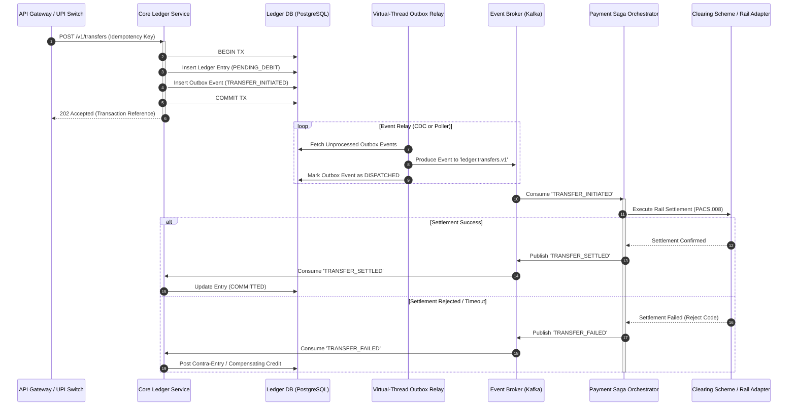

In a mission-critical core banking system, the two-phase commit (2PC) protocol is an anti-pattern. While distributed transactions across multiple microservice databases sound mathematically reassuring on paper, in production they introduce catastrophic availability bottlenecks, brittle locks, and distributed deadlocks. When your system processes tens of thousands of payment instructions per second across payment schemes like UPI, NEFT, or UK Faster Payments (PACS), network partitions are an hourly reality, not an edge case.

Consider how a physical bank vault historically operated: an escrow officer never leaves the building to confirm that the recipient's bank credited the beneficiary before writing into the local ledger. Instead, the clerk stamps the debit entry directly into the local book of accounts and, in the exact same physical motion, drops a sealed courier dispatch into an internal outbox bin. If the courier gets delayed by bad weather, the local book remains mathematically balanced, and the dispatch is retried until transit receipts return. If the receiving bank rejects the payment, the officer does not erase the ink; they record an explicit, auditable counter-entry.

Translating this discipline into high-throughput software demands two symbiotic patterns: **Distributed Sagas** to manage multi-boundary state transitions through compensating transactions, and the **Transactional Outbox Pattern** to guarantee atomic dual-writes without distributed locks.

---

## 1. Architectural Blueprint

The architecture isolates ledger storage from external clearing boundaries. Every state mutation to the primary book of record is inextricably coupled to an event insertion within the same atomic relational database transaction. A decoupled relay extracts these events and dispatches them across a durable messaging backbone (Apache Kafka), where a centralized Saga Orchestrator drives forward steps and compensation paths.



### Boundary Separation and Isolation

1. **The Ledger Boundary**: Owns double-entry integrity. It executes only local ACID transactions and exposes no synchronous egress calls to external payment rails inside its transactional boundaries.
2. **The Relay Boundary**: Asynchronously bridges persistent state to Kafka without holding database-level read locks or blocking the ledger ingest path.
3. **The Saga Orchestration Boundary**: Maintains the workflow state machine. It is responsible for timeouts, retry policies, clearing network integration, and executing compensating transactions (contra-entries).

---

## 2. Core Engineering Deep Dive & Technical Invariants

Operating a financial ledger under heavy throughput requires strict architectural invariants. Failure to enforce these causes phantom debits, unreconciled clearing positions, and non-compliance with central bank auditors.

### Invariant 1: Local Transactional Atomicity (No Dual Writes)
A microservice must never write to its relational database and subsequently publish an event directly to Kafka in the same application execution flow:

$$\text{P}(\text{DB Commit} \land \neg\text{Kafka Publish}) > 0$$

Network partitions, JVM pauses, or pod evictions between the database commit and the broker acknowledgment cause data drift. The database write and the outbox record must share the same physical transaction boundary:

```sql
BEGIN TRANSACTION;
INSERT INTO account_ledger (entry_id, account_id, amount, direction, state) 
VALUES ('tx_101', 'acc_902', 50000.00, 'DEBIT', 'PENDING');

INSERT INTO transactional_outbox (event_id, aggregate_type, aggregate_id, event_type, payload) 
VALUES ('evt_501', 'LEDGER_ENTRY', 'tx_101', 'FUNDS_RESERVED', '{"amount": 50000.00, ...}');
COMMIT;
```

### Invariant 2: Immutability via Contra-Entries
In double-entry bookkeeping, rows are never deleted or rolled back once committed. If an account has been debited in a `PENDING` state and the downstream payment rail returns an unrecoverable failure (e.g., account closed, invalid routing number), the Saga Orchestrator triggers a **compensating transaction**. 

This compensation is not an SQL `UPDATE` setting the old balance back. It is a new, discrete credit ledger entry known as a **contra-entry**, annotated with the original transaction reference. The audit log remains complete, append-only, and verifiable.

### Invariant 3: Idempotency Key Derivatives
Every saga step must be strictly idempotent. Banking payloads carry a deterministic `Idempotency-Key` passed from upstream API clients. For every downstream call, the Saga Orchestrator derives a deterministic key scoped to the step:

$$\text{StepKey} = \text{HMAC-SHA256}(\text{RootIdempotencyKey}, \text{StepName})$$

If the clearing rail experiences a TCP handshake drop after accepting a transfer, resending the instruction with the derived Step Key prevents double-crediting the beneficiary account.

### Invariant 4: Zero-Trust Boundary Isolation with mTLS & Cryptographic Nonces
In an enterprise multi-tenant cloud environment, communication between the Ledger Service, Kafka cluster, and Orchestrator must enforce mutual TLS (mTLS) with ephemeral, hardware-backed keys. Every event written to the outbox contains a cryptographically signed hash of its payload generated by an internal service key. If an event is tampered with in transit or within the broker partition, the consumer rejects it immediately before executing state changes.

---

## 3. Production Code Implementation

The following implementation delivers a high-throughput, concurrency-safe Ledger and Outbox engine written in Java. It leverages modern Java concurrency primitives to scale relay throughput without thread starvation.

### 3.1 The Atomic Ledger & Outbox Service

This service writes both the immutable double-entry ledger record and the outbox event in a single atomic database unit of work.

```java
package com.enterprise.ledger.service;

import com.fasterxml.jackson.databind.ObjectMapper;
import org.slf4j.Logger;
import org.slf4j.LoggerFactory;

import javax.sql.DataSource;
import java.math.BigDecimal;
import java.sql.Connection;
import java.sql.PreparedStatement;
import java.sql.SQLException;
import java.time.Instant;
import java.util.Map;
import java.util.Objects;
import java.util.UUID;

public class LedgerPostingService {

    private static final Logger log = LoggerFactory.getLogger(LedgerPostingService.class);
    private final DataSource dataSource;
    private final ObjectMapper objectMapper;

    public LedgerPostingService(DataSource dataSource, ObjectMapper objectMapper) {
        this.dataSource = Objects.requireNonNull(dataSource);
        this.objectMapper = Objects.requireNonNull(objectMapper);
    }

    public record PostingCommand(
        String transactionId,
        String sourceAccountId,
        String destinationAccountId,
        BigDecimal amount,
        String currency,
        String idempotencyKey
    ) {}

    public void postPendingDebit(PostingCommand command) throws SQLException {
        String insertLedgerSql = """
            INSERT INTO account_ledger_entries (
                entry_id, account_id, amount, currency, direction, status, idempotency_key, created_at
            ) VALUES (?, ?, ?, ?, ?, ?, ?, ?)
            ON CONFLICT (idempotency_key) DO NOTHING;
            """;

        String insertOutboxSql = """
            INSERT INTO transactional_outbox (
                event_id, aggregate_type, aggregate_id, event_type, payload, created_at, status
            ) VALUES (?, ?, ?, ?, ?::jsonb, ?, 'PENDING');
            """;

        try (Connection connection = dataSource.getConnection()) {
            connection.setAutoCommit(false);
            try (PreparedStatement ledgerStmt = connection.prepareStatement(insertLedgerSql);
                 PreparedStatement outboxStmt = connection.prepareStatement(insertOutboxSql)) {

                long now = Instant.now().toEpochMilli();
                String entryId = "ENT-" + UUID.randomUUID();

                // 1. Ledger Entry
                ledgerStmt.setString(1, entryId);
                ledgerStmt.setString(2, command.sourceAccountId());
                ledgerStmt.setBigDecimal(3, command.amount());
                ledgerStmt.setString(4, command.currency());
                ledgerStmt.setString(5, "DEBIT");
                ledgerStmt.setString(6, "PENDING_SETTLEMENT");
                ledgerStmt.setString(7, command.idempotencyKey());
                ledgerStmt.setLong(8, now);

                int rowsInserted = ledgerStmt.executeUpdate();
                if (rowsInserted == 0) {
                    log.warn("Duplicate request detected for idempotency key: {}", command.idempotencyKey());
                    connection.rollback();
                    return;
                }

                // 2. Outbox Event
                Map<String, Object> payload = Map.of(
                    "transactionId", command.transactionId(),
                    "ledgerEntryId", entryId,
                    "sourceAccountId", command.sourceAccountId(),
                    "destinationAccountId", command.destinationAccountId(),
                    "amount", command.amount(),
                    "currency", command.currency(),
                    "idempotencyKey", command.idempotencyKey()
                );

                outboxStmt.setString(1, "EVT-" + UUID.randomUUID());
                outboxStmt.setString(2, "PAYMENT_INSTRUCTION");
                outboxStmt.setString(3, command.transactionId());
                outboxStmt.setString(4, "FUNDS_RESERVED");
                outboxStmt.setString(5, objectMapper.writeValueAsString(payload));
                outboxStmt.setLong(6, now);

                outboxStmt.executeUpdate();

                connection.commit();
                log.info("Ledger reservation committed atomically with outbox: {}", command.transactionId());
            } catch (Exception ex) {
                connection.rollback();
                log.error("Failed to commit ledger transaction, rolled back: {}", command.transactionId(), ex);
                throw new SQLException("Transaction aborted due to integrity failure", ex);
            } finally {
                connection.setAutoCommit(true);
            }
        }
    }
}
```

### 3.2 High-Throughput Outbox Relay with Virtual Threads

Polling relational outbox tables traditionally causes locking contention and deadlocks under scale. To mitigate this without dedicated Change Data Capture (CDC) infrastructure, the relay below utilizes `SELECT FOR UPDATE SKIP LOCKED` combined with Java Virtual Threads. This architecture handles thousands of partition flushes concurrently without starving platform thread pools.

```java
package com.enterprise.ledger.relay;

import org.apache.kafka.clients.producer.KafkaProducer;
import org.apache.kafka.clients.producer.ProducerRecord;
import org.apache.kafka.clients.producer.RecordMetadata;
import org.slf4j.Logger;
import org.slf4j.LoggerFactory;

import javax.sql.DataSource;
import java.sql.Connection;
import java.sql.PreparedStatement;
import java.sql.ResultSet;
import java.util.ArrayList;
import java.util.List;
import java.util.concurrent.ExecutorService;
import java.util.concurrent.Executors;

public class OutboxEventRelay implements AutoCloseable {

    private static final Logger log = LoggerFactory.getLogger(OutboxEventRelay.class);
    private final DataSource dataSource;
    private final KafkaProducer<String, String> producer;
    private final String topic;
    private final ExecutorService virtualThreadExecutor;
    private volatile boolean running = true;

    public OutboxEventRelay(DataSource dataSource, KafkaProducer<String, String> producer, String topic) {
        this.dataSource = dataSource;
        this.producer = producer;
        this.topic = topic;
        this.virtualThreadExecutor = Executors.newVirtualThreadPerTaskExecutor();
    }

    public record OutboxRecord(String eventId, String aggregateId, String eventType, String payload) {}

    public void startRelayWorker() {
        virtualThreadExecutor.submit(() -> {
            while (running) {
                try {
                    processBatch();
                } catch (InterruptedException e) {
                    Thread.currentThread().interrupt();
                    break;
                } catch (Exception e) {
                    log.error("Outbox poll cycle failure, backing off", e);
                    try {
                        Thread.sleep(500);
                    } catch (InterruptedException ie) {
                        Thread.currentThread().interrupt();
                        break;
                    }
                }
            }
        });
    }

    private void processBatch() throws Exception {
        String selectSql = """
            SELECT event_id, aggregate_id, event_type, payload
            FROM transactional_outbox
            WHERE status = 'PENDING'
            ORDER BY created_at ASC
            LIMIT 100
            FOR UPDATE SKIP LOCKED;
            """;

        String updateSql = "UPDATE transactional_outbox SET status = 'DISPATCHED' WHERE event_id = ?";

        try (Connection connection = dataSource.getConnection()) {
            connection.setAutoCommit(false);
            List<OutboxRecord> recordsToDispatch = new ArrayList<>();

            try (PreparedStatement selectStmt = connection.prepareStatement(selectSql);
                 ResultSet rs = selectStmt.executeQuery()) {

                while (rs.next()) {
                    recordsToDispatch.add(new OutboxRecord(
                        rs.getString("event_id"),
                        rs.getString("aggregate_id"),
                        rs.getString("event_type"),
                        rs.getString("payload")
                    ));
                }
            }

            if (recordsToDispatch.isEmpty()) {
                connection.rollback();
                Thread.sleep(50); // Idle backoff
                return;
            }

            // Publish events to Kafka
            for (OutboxRecord event : recordsToDispatch) {
                ProducerRecord<String, String> kafkaRecord = 
                    new ProducerRecord<>(topic, event.aggregateId(), event.payload());
                
                // Synchronous wait per item within transaction batch boundary
                RecordMetadata metadata = producer.send(kafkaRecord).get();
                log.debug("Event {} published to partition {} offset {}", 
                    event.eventId(), metadata.partition(), metadata.offset());
            }

            // Mark events as dispatched
            try (PreparedStatement updateStmt = connection.prepareStatement(updateSql)) {
                for (OutboxRecord event : recordsToDispatch) {
                    updateStmt.setString(1, event.eventId());
                    updateStmt.addBatch();
                }
                updateStmt.executeBatch();
            }

            connection.commit();
            log.info("Successfully dispatched batch of {} outbox events", recordsToDispatch.size());
        }
    }

    @Override
    public void close() {
        this.running = false;
        this.virtualThreadExecutor.close();
    }
}
```

### 3.3 Saga Orchestration: The Compensating Flow Engine

When the downstream payment network rejects an outbound clearing operation, the Orchestrator runs a forward-recovery or compensation path. The following component processes settlement results and coordinates the ledger contra-entry.

```java
package com.enterprise.ledger.saga;

import org.slf4j.Logger;
import org.slf4j.LoggerFactory;

import javax.sql.DataSource;
import java.math.BigDecimal;
import java.sql.Connection;
import java.sql.PreparedStatement;
import java.sql.SQLException;
import java.util.UUID;

public class PaymentSagaOrchestrator {

    private static final Logger log = LoggerFactory.getLogger(PaymentSagaOrchestrator.class);
    private final DataSource dataSource;

    public PaymentSagaOrchestrator(DataSource dataSource) {
        this.dataSource = dataSource;
    }

    public enum SettlementResult {
        SUCCESS,
        REJECTED_INSUFFICIENT_SCHEME_COVER,
        REJECTED_INVALID_BENEFICIARY,
        TIMEOUT_DOWNSTREAM
    }

    public void handleSettlementCallback(String transactionId, String accountId, BigDecimal amount, 
                                         SettlementResult result, String parentIdempotencyKey) {
        switch (result) {
            case SUCCESS -> finalizeTransaction(transactionId);
            case REJECTED_INSUFFICIENT_SCHEME_COVER, 
                 REJECTED_INVALID_BENEFICIARY, 
                 TIMEOUT_DOWNSTREAM -> executeCompensatingCredit(transactionId, accountId, amount, parentIdempotencyKey);
        }
    }

    private void finalizeTransaction(String transactionId) {
        String sql = "UPDATE account_ledger_entries SET status = 'COMMITTED' WHERE entry_id = ?";
        try (Connection conn = dataSource.getConnection();
             PreparedStatement ps = conn.prepareStatement(sql)) {
            ps.setString(1, transactionId);
            ps.executeUpdate();
            log.info("Transaction {} marked as COMMITTED", transactionId);
        } catch (SQLException e) {
            log.error("Failed to mark transaction {} as COMMITTED", transactionId, e);
        }
    }

    private void executeCompensatingCredit(String transactionId, String accountId, BigDecimal amount, String rootKey) {
        log.warn("Executing compensating contra-entry for transaction: {}", transactionId);

        String insertContraSql = """
            INSERT INTO account_ledger_entries (
                entry_id, account_id, amount, currency, direction, status, idempotency_key, created_at
            ) VALUES (?, ?, ?, 'INR', 'CREDIT', 'COMPENSATING_REVERSAL', ?, ?)
            ON CONFLICT (idempotency_key) DO NOTHING;
            """;

        String updateOriginalSql = """
            UPDATE account_ledger_entries 
            SET status = 'REVERSED' 
            WHERE entry_id = ?;
            """;

        String derivedKey = "COMPENSATE-" + rootKey;

        try (Connection conn = dataSource.getConnection()) {
            conn.setAutoCommit(false);
            try (PreparedStatement contraStmt = conn.prepareStatement(insertContraSql);
                 PreparedStatement updateStmt = conn.prepareStatement(updateOriginalSql)) {

                // 1. Insert offsetting credit (contra-entry)
                contraStmt.setString(1, "ENT-REV-" + UUID.randomUUID());
                contraStmt.setString(2, accountId);
                contraStmt.setBigDecimal(3, amount);
                contraStmt.setString(4, derivedKey);
                contraStmt.setLong(5, System.currentTimeMillis());
                contraStmt.executeUpdate();

                // 2. Mark parent entry reversed
                updateStmt.setString(1, transactionId);
                updateStmt.executeUpdate();

                conn.commit();
                log.info("Compensating transaction successfully settled for transaction: {}", transactionId);
            } catch (SQLException ex) {
                conn.rollback();
                log.error("Failed to apply compensation transaction: {}", transactionId, ex);
                throw ex;
            } finally {
                conn.setAutoCommit(true);
            }
        } catch (SQLException e) {
            log.error("Database connection failure while compensating: {}", transactionId, e);
        }
    }
}
```

---

## 4. Topic-Specific Operational Realities

Deploying distributed sagas with transactional outboxes in banking ledgers introduces operational complexities that standard CRUD architectures never encounter.

### Outbox Table Bloat and WAL Exhaustion
In systems processing $10^7$ daily transactions, the outbox table becomes a high-velocity write-and-delete target. In PostgreSQL, this pattern triggers aggressive Write-Ahead Logging (WAL) bloat and dead-tuple accumulation. Standard `VACUUM` processes struggle to keep pace with sustained row churn.

**Remediation:**
* **Partition by Day/Hour:** Use declarative range partitioning on the outbox table by `created_at`. When an entire partition window has been dispatched, drop or detach the partition table completely rather than issuing millions of row-level `DELETE` statements.
* **Transition to Log-Mining CDC:** At ultra-high scale, replace SQL polling relays with low-impact engine log readers like Debezium. Debezium decodes the PostgreSQL WAL or Oracle Redo Log directly into Kafka, eliminating relational `UPDATE` operations on the outbox entirely.

```
+-----------------------------------------------------------------------------------------+
| RELATIONAL DATABASE ENGINE                                                              |
|                                                                                         |
|  [ Ledger Tables ] <--- Local ACID TX ---> [ Outbox Table (Partitioned by Range) ]     |
|         |                                                      |                        |
|         v                                                      v                        |
|   Append-Only Ledger                             WAL / Redo Engine Log                  |
+----------------------------------------------------------------|------------------------+
                                                                 |
                                                  Streaming Logical Decoding
                                                                 |
                                                                 v
                                                     [ Debezium / Kafka Connect ]
                                                                 |
                                                                 v
                                                      [ Kafka Event Topics ]
```

### In-Flight Network Timeouts during Clearing Cycles
A critical operational challenge occurs when an outbound settlement request to a clearing house (e.g., central bank gateway) times out at the transport layer. The Saga Orchestrator is left in a state of indeterminacy: *Was the beneficiary credited, or did the network drop the frame prior to settlement?*

Executing an immediate compensating credit while the central bank successfully clears the payment results in an immediate negative unhedged position for the issuing bank (a "duplicate release of funds").

**Production Mitigation:**
1. **Never compensate on unknown timeout errors immediately.** The saga state machine transitions to an `AWAITING_RECONCILIATION` state.
2. The orchestrator dispatches an explicit out-of-band **Transaction Status Inquiry** (e.g., ISO 20022 `pacs.028` message) to determine authoritative clearing state.
3. If the scheme confirms settlement: trigger the forward commit path.
4. Only if the scheme confirms explicit rejection or absolute lack of receipt: trigger the compensating contra-entry.

### Dead-Letter Queue (DLQ) Auto-Triage & Operational Ledger Reconciliation
Even with robust retry policies, poison pill payloads, schema mismatches, or infrastructure failures can route messages to Kafka Dead-Letter Topics (DLQ). In core banking, unhandled DLQ messages are considered active operational financial risks.

Every DLQ message must be correlated with its root outbox event and stored in an immutable, append-only **Operational Exceptions Ledger**. A secondary reconciliation job periodically checks for:

$$\Delta = \text{Sum}(\text{Initiated Outbox Debits}) - [\text{Sum}(\text{Committed Settled}) + \text{Sum}(\text{Reversed Contra-Entries})]$$

If $\Delta \neq 0$ outside of acceptable real-time transit thresholds (typically over 60 seconds), automated alerting triggers an alert to operations teams before day-end settlement reconciliation fails.

---

### Conclusion & Strategic Takeaways

Migrating core banking infrastructure away from distributed locking to asynchronous, saga-driven workflows is an architectural imperative for operating at internet scale. By adopting the **Transactional Outbox Pattern**, you confine ACID guarantees strictly to where they belong—the local database engine—while offloading workflow orchestration to distributed streaming fabrics.

1. **Dual writes must be treated as system bugs:** Never execute a network I/O write immediately following a database commit within the same execution path. Rely on an outbox pattern backed by atomic local transactions.
2. **Audit trails require complete immutability:** Never roll back state in place. Use explicit, idempotent contra-entries for all compensating saga branches to guarantee end-to-end ledger verifiability.
3. **Plan for network ambiguity:** Design your saga state machines around asynchronous inquiry-verification states rather than hasty, speculative compensation.